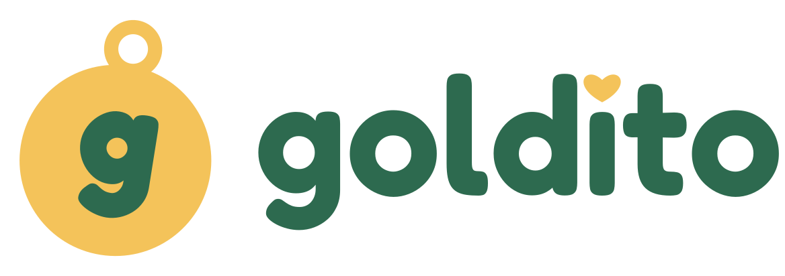
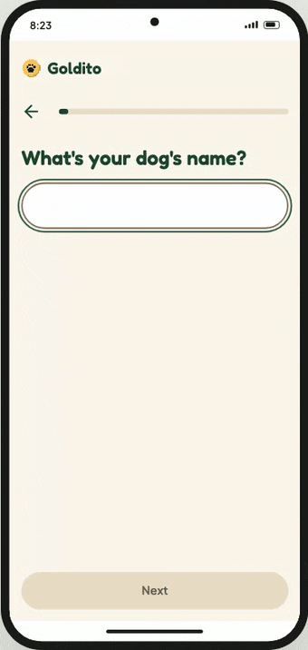

# 2 Rivers

**AI that does the paperwork of caregiving.**

Caregivers spend half their day writing reports, logs and updates. We let them snap, tap and send, and AI writes the rest.

We are based in Toronto. The name comes from two waters that matter to us: the Han River in Seoul and Lake Ontario.

## What we build

| | Care | Product | Status |
| :--- | :--- | :--- | :--- |
| 1 | **Pets** | Goldito: daily reports, photos and a pet diary for sitters and their clients | Building |
| 2 | **Seniors** | Care records and family updates for senior care homes | Planned |
| 3 | **Kids** | Daily updates for child care | Planned |

## Goldito

A pet sitter sends one link to a client. The client sees the day in a simple feed: photos, meds, meals and a short note. The sitter taps a few chips, and the AI writes the report in their own voice.

- Works in the browser, no install for pet owners
- Built for independent sitters, not for a marketplace
- Owners can decorate their pet's diary and a virtual pet

## Work with us

We are a small team and we are looking for pet sitters to try Goldito early. Open an issue in [goldito-web](https://github.com/2-Rivers/goldito-web/issues) or reach out through the team.

---

Goldito started at the Nebius x NVIDIA Global AI Hackathon, built on Nemotron and Nebius Token Factory. The original repository is [minsikpaul92/Goldito](https://github.com/minsikpaul92/Goldito).
